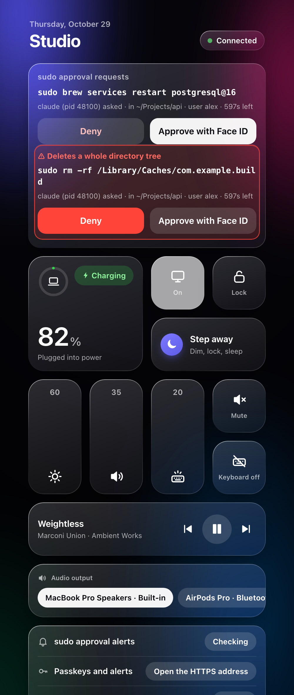
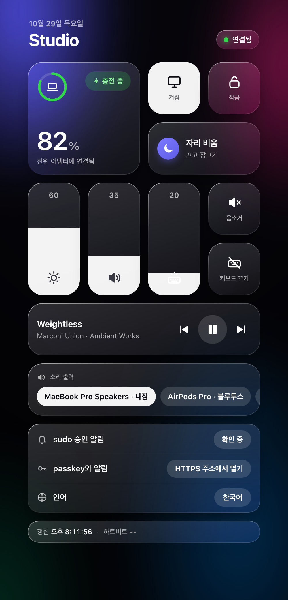
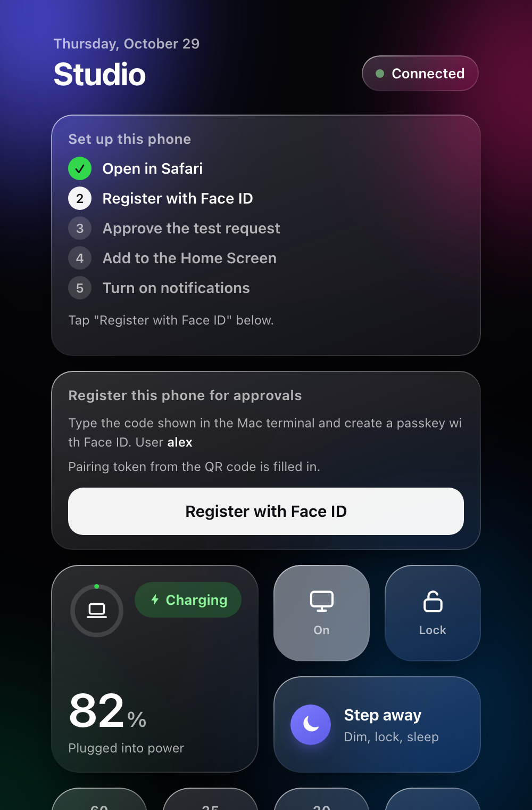

# Macmote

[English](README.md) | 한국어

[](https://github.com/pysunn14/macmote/actions/workflows/ci.yml)

맥의 `sudo`를 아이폰 Face ID로 승인하고, 같은 페이지에서 맥을 제어하는 도구입니다.

<p align="center">
  
  
  
</p>

- 맥에서 `sudo`가 실행되면 폰에 명령이 담긴 알림이 옵니다. Face ID로 승인하거나 거부합니다. 맥의
  Touch ID 창도 동시에 뜹니다.
- 페이지에서 화면 켜기/끄기, 잠금, 볼륨, 밝기, 키보드 백라이트, 배터리, 지금 재생 중, 출력 장치 선택도
  할 수 있습니다. 홈 화면에 추가하면 앱처럼 쓸 수 있습니다.
- 한국어와 영어를 지원합니다.

맥에서 코딩 에이전트를 돌려 놓고 자리에 없을 때 쓰려고 만들었습니다.

## 설치

```sh
brew tap pysunn14/macmote
brew install macmote
macmote setup
```

`setup`이 도우미 빌드, 서버 실행, Tailscale Serve 설정, sudo 훅 설치(비밀번호 또는 Touch ID 입력)를
하고 QR 코드를 출력합니다. 아이폰 카메라로 찍고 페이지의 안내를 따라가면 됩니다.

필요한 것:

- Xcode Command Line Tools가 설치된 macOS
- HTTPS 인증서를 켠 Tailscale (관리 콘솔 → DNS → HTTPS Certificates). 다른 HTTPS 터널도 가능합니다.
  [docs/architecture.md](docs/architecture.md#configuration) 참고
- iCloud 키체인이 켜진 아이폰 (passkey에 필요), iOS 16.4 이상

## 사용

- 홈 화면에서 페이지를 열면 대기 중인 `sudo` 요청이 맨 위에 보입니다. 위험한 명령(재귀 삭제, 디스크
  지우기, 다운로드를 셸에 파이프 등)은 빨간색으로 표시됩니다.
- 알림은 Safari 탭이 아니라 홈 화면 앱에서만 옵니다. 아이콘을 다시 추가했으면 알림도 다시 켜야 합니다.
- `macmote status`로 실행 상태와 대기 중인 요청을 볼 수 있습니다. 전체 명령은 [docs/cli.md](docs/cli.md)에
  있습니다.
- 알려진 문제와 해결 방법은 [docs/macos-notes.md](docs/macos-notes.md)에 있습니다.

## 보안

승인은 무작위 challenge에 대한 passkey 서명입니다. 검증은 `sudo` 안에서 root로 실행되는 PAM 모듈이
root 전용 파일의 공개키로 합니다. 폰과 통신하는 서버는 일반 사용자 권한으로 돌며 메시지를 전달만
하므로, 사용자 권한 프로세스(예: 에이전트)가 서버를 수정하더라도 자기 `sudo`를 승인할 수 없습니다.
폰 등록은 맥에서 `sudo`로 하며, 서버를 거치지 않는 일회용 코드가 필요합니다.

한계: `sudo`만 처리하고 macOS 자체 인증 창은 다루지 않습니다. 페이지는 사용자 권한 서버가 제공하므로
악의적인 로컬 프로세스가 실제 승인 대상과 다른 명령을 표시할 수 있습니다. [SECURITY.md](SECURITY.md)를
참고하세요.

## 더 보기

- [docs/architecture.md](docs/architecture.md): 구성 요소와 승인 흐름
- [CONTRIBUTING.md](CONTRIBUTING.md): 개발
- 라이선스: MIT
