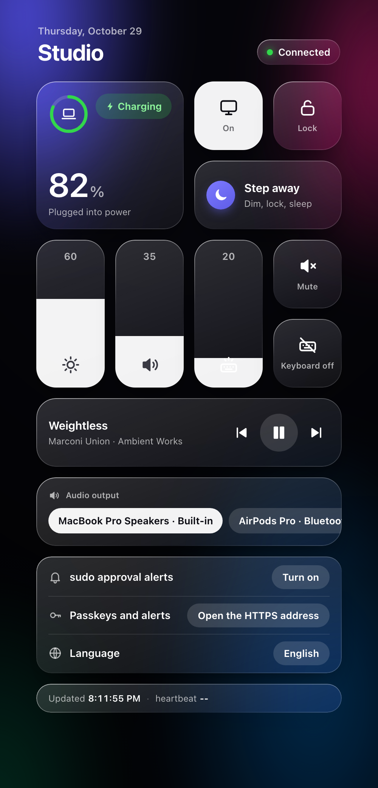

# Macmote

English | [한국어](README.ko.md)

[](https://github.com/pysunn14/macmote/actions/workflows/ci.yml)

Approve `sudo` on your Mac from your iPhone with Face ID, and control the Mac from the same page.

<p align="center">
  
  
  
</p>

- When `sudo` runs on the Mac, the phone gets a notification with the command. Approve it with
  Face ID or deny it. The Mac's own Touch ID dialog is shown at the same time.
- The page also has display on/off, lock, volume, brightness, keyboard backlight, battery, now
  playing and audio output selection. Add it to the Home Screen to use it like an app.
- English and Korean.

Useful when a coding agent runs on the Mac and you are not sitting in front of it.

## Install

```sh
brew tap pysunn14/macmote
brew install macmote
macmote setup
```

`setup` builds the helpers, starts the server, configures Tailscale Serve, installs the sudo
hook (asks for your password or Touch ID) and prints a QR code. Scan it with the iPhone camera
and follow the steps on the page.

Requirements:

- macOS with the Xcode Command Line Tools
- Tailscale with HTTPS certificates enabled (admin console → DNS → HTTPS Certificates).
  Another HTTPS tunnel can be used instead; see [docs/architecture.md](docs/architecture.md#configuration)
- iPhone with iCloud Keychain on (needed for passkeys), iOS 16.4 or later

## Usage

- Open the page from the Home Screen. Pending `sudo` requests are shown at the top; risky
  commands (recursive delete, disk erase, piping a download into a shell, …) are marked red.
- Notifications only work from the Home Screen app, not from a Safari tab. After re-adding
  the icon, turn them on again.
- `macmote status` shows what is running and what is waiting. All commands: [docs/cli.md](docs/cli.md).
- Known problems and fixes: [docs/macos-notes.md](docs/macos-notes.md).

## Security

An approval is a passkey signature over a random challenge. It is verified by a PAM module
running as root inside `sudo`, with public keys from a root-only file. The server that talks to
the phone runs as the normal user and only relays messages, so a process running as the user
(an agent, for example) cannot approve its own `sudo` even if it modifies the server. Pairing a
phone requires `sudo` on the Mac and a one-time code that does not go through the server.

Limitations: only `sudo` is handled, not macOS's own authorization dialogs. The page is served
by the user-level server, so a hostile local process could display a different command than the
one being approved. See [SECURITY.md](SECURITY.md).

## More

- [docs/architecture.md](docs/architecture.md): components and the approval flow
- [CONTRIBUTING.md](CONTRIBUTING.md): development
- License: MIT
